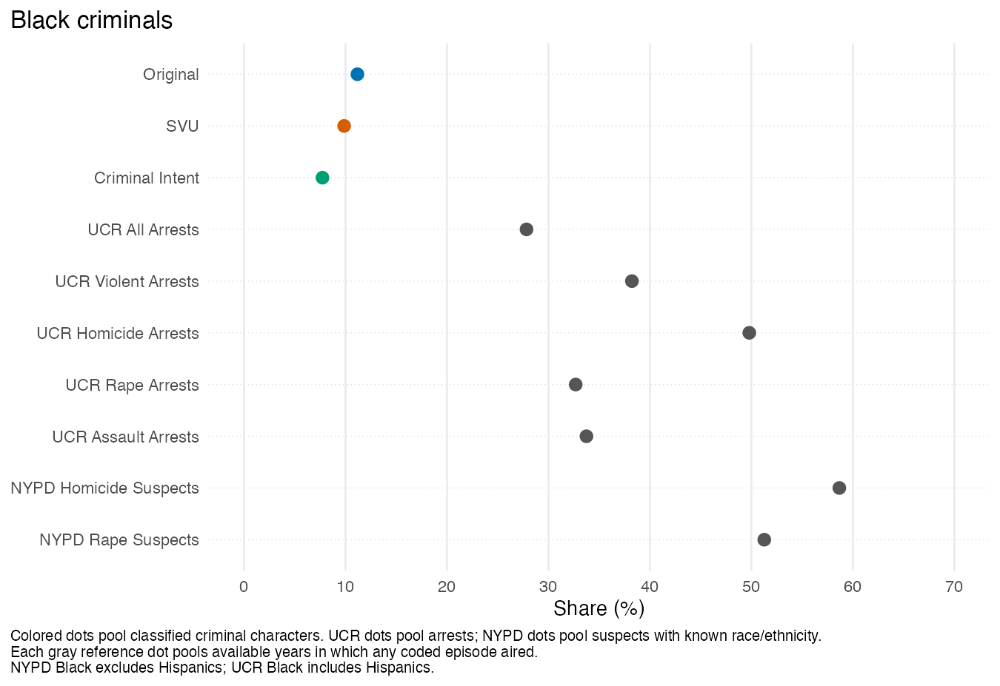

# The Face of Crime in Prime Time

Gaurav Sood and Daniel Trielli

[Paper](ms/main.pdf) · [Audit and corrected results](docs/audit.md) · [Data](data/README.md)

## Question and findings

How do the race and gender of victims and criminals portrayed in three *Law & Order* series compare with historical crime and population records? The coded dataset contains 731 episodes: 151 from the original series, 194 from *Criminal Intent*, and 386 from *Special Victims Unit*.

Among characters whose race was classified, Black criminal and victim shares are lower than several historical arrest and victimization benchmarks. Those sources differ in crimes, geography, years, and how people enter the records. The generated [paper](ms/main.pdf) reports the shares for each series. The supporting information documents reference coverage, definitions, denominators, and pooling.



The [paper](ms/main.pdf) gives the other race and gender comparisons. The [audit](docs/audit.md) records the original and corrected values, remaining source discrepancies, and interpretation limits.

## Reproduce

Use R 4.6, `make`, Poppler (for `pdftools`), and a LaTeX installation with `latexmk`. On Linux, install `libpoppler-cpp-dev` before restoring the R packages.

```sh
make restore
make check
```

`make check` regenerates the data products, figures, tables, and PDF, then runs `lintr` and `testthat`. `make ci-docker` runs the same checks in a standard Rocker image when Docker is available. The analysis retains the historical survey years and pins a BJS NCVS API response for them. Source SHA-256 hashes are in [`data/source_manifest.csv`](data/source_manifest.csv).

`make download` restores missing source files from the manifest and rejects changed upstream bytes.

## Layout

| Path | Contents |
|---|---|
| `data/raw/` | Preserved episode sheets, source workbooks, API responses, and reports. |
| `data/reference/` | Original analytical handoffs retained for validation. |
| `data/extracted/` | Rebuilt, named CSV extracts; ignored by Git. |
| `data/build/` | Rebuildable intermediate R objects; ignored by Git. |
| `R/` | Reading, coding, analysis, figure, and table functions. |
| `scripts/` | Configuration and ordered pipeline stages. |
| `figs/`, `tabs/` | Generated exhibits, numerical results, and manuscript macros. |
| `ms/` | Editable LaTeX manuscript, bibliography, and compiled PDF. |
| `tests/testthat/` | Source, coding, denominator, and benchmark tests. |

The pipeline runs `scripts/01_prepare_data.R` through `scripts/04_tables.R` with `scripts/99_run_all.R`. Each stage reads a file left by its predecessor. The manuscript inputs generated tables and macros, so corrected values reach both the exhibits and prose. [`docs/path_map.csv`](docs/path_map.csv) records published old and new data paths.

## Data and license

The coded episode data and historical comparison files come from the original repository. The data documentation describes the source files and their limits. This repository retains the original [CC BY 2.0](https://creativecommons.org/licenses/by/2.0/) notice.
